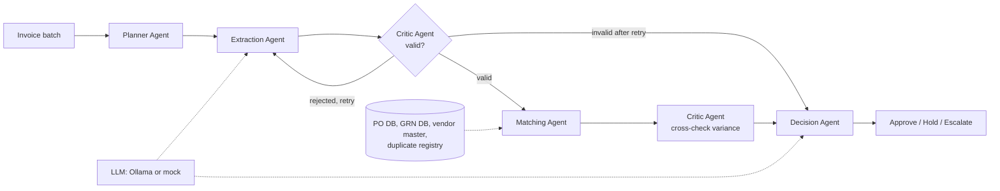

# Invoice Three-Way Match Agents

A multi-agent accounts-payable workflow. Before paying a vendor invoice, finance teams must check it
against the **purchase order** (what was ordered) and the **goods receipt note** (what arrived).
Doing this by hand is slow and error-prone, so duplicates and overpayments slip through.
This PoC shows how cooperating agents plan, extract, validate, match and decide, using synthetic data only.

## Run it

```bash
python -m venv .venv && source .venv/bin/activate      # Windows: .venv\Scripts\activate
pip install -r requirements.txt
streamlit run app.py
```

No LLM is needed: the default **Mock** backend is rule-based. To use a local model:

```bash
ollama pull llama3.2        # or qwen2.5:3b on a low-RAM laptop
```
then pick "Ollama (local model)" in the sidebar. If Ollama is unreachable the app falls back to the mock.

Headless check (no UI): `python run_cli.py --verbose` (add `--ollama llama3.2` to use a model).

## Agents and workflow



| Agent | What it does |
|---|---|
| Planner | Sequences the batch by due date, then amount; marks invoices due within 7 days as urgent |
| Extraction | Parses invoice text into a Pydantic schema (LLM if available, otherwise a fast parser) |
| Critic | Rejects extractions whose arithmetic fails and triggers a retry; later checks every money variance is explained |
| Matching | Invoice vs PO vs GRN: price, quantity received, tax rate, vendor, duplicates |
| Decision | Applies rules, then writes a plain-language reason |

**Decision rules** (`tools.decide`): no issues means approved. Duplicate, unknown vendor, missing PO, vendor
mismatch or unexplained variance means escalated. Other mismatches are held for vendor correction, or
escalated when the amount at risk is 10,000 INR or more (`config.py`).

**The Critic loop is real.** About 40% of generated invoices use thousand separators (`1,250.00`). The fast
parser misreads them, the Critic notices the arithmetic no longer adds up, and the Extraction Agent retries
with the robust parser. Watch for "REJECTED ... retry" lines in the live trace.

## Files

| File | Purpose |
|---|---|
| `app.py` | Streamlit UI: run agents, live trace, results, architecture |
| `orchestrator.py` | LangGraph graph (with a plain-Python fallback), batch runner, evaluation |
| `agents.py` | The five agents |
| `tools.py` | Parsing, validation, three-way match, decision rules |
| `data_gen.py` | Synthetic vendors, POs, GRNs and invoices with seeded errors and an answer key |
| `llm.py` | Mock and Ollama backends |
| `schemas.py`, `config.py` | Data models and thresholds |
| `run_cli.py` | Headless run with metrics |

## Seeded errors and validation

The generator injects: price mismatch, billed quantity above goods received, duplicate invoice, unknown
vendor (with a non-existent PO), and wrong tax rate. Because the answer key is known, the Results tab reports
errors caught, correct issue type, false positives, retries recovered, and amount at risk detected vs true.

## Limitations

- Synthetic data and a fixed invoice layout. The parser would not survive real vendor formats.
- Matching is deterministic by design, so scores on this data are high. That shows the pipeline works,
  not that it would score the same on messy real invoices. With a small Ollama model, extraction errors are
  expected and the Critic loop is what catches them.
- Time savings use assumptions you set in the sidebar. They are estimates, not measurements.
- No real OCR, ERP integration or authentication.

## Future scope

OCR for scanned PDFs and photos, ERP connectors (SAP, Tally), fuzzy vendor-name matching, vendor fraud
pattern detection, a human-in-the-loop approval screen, and MCP-exposed tools for PO lookup.
